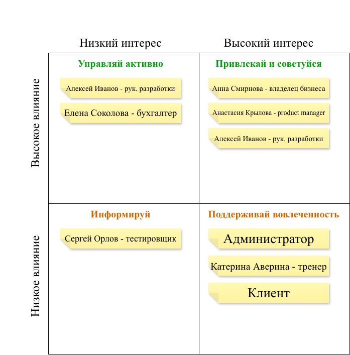

# Анализ стейкхолдеров.
## 1. Реестр стейкхолдеров.

| ID | Имя / роль | Организация | Интересы | Влияние (1-5) |  Стратегия коммуникации |
| :--- | :--- | :--- | :--- | :--- | :--- |
| SH-01 | Анна Смирнова - владелец бизнеса | Фитнес-клуб "Fit Space" | Рост прибыли, качественный сервис | 5 | Регулярно информировать о статусе, привлекать к ключевым решениям |
| SH-02 | Анастасия Крылова - product manager | Фитнес-клуб "Fit Space" | Улучшение клиентского опыта, рост конверсии | 5 | Постоянное взаимодействие, совместное принятие решений |
| SH-03 | Билигма Баторова - бизнес-аналитик |  IT-отдел | Понять потребности бизнеса, сформировать требования | 4 | Регулярно взаимодействовать со всеми ключевыми участниками |
| SH-04 | Алексей Иванов - руководитель разработки  | IT-отдел | Реализуемость решения, сроки, ресурсы | 4 | Регулярные встречи, согласование требований и технических решений |
| SH-05 | Сергей Орлов - тестировщик | IT-отдел |  Четкие критерии приемки | 4 | Регулярные встречи, согласование требований и технических решений | 
| SH-06 | Катерина Аверина - тренер | Фитнес-клуб "Fit Space" | Видеть список записавшихся на занятие, управлять своим расписанием |  |  |
| SH-07 | Администратор ресепшена | Фитнес-клуб "Fit Space" | Быстро оформлять абонементы, записывать на занятия, не путаться в расписании |  |  |
| SH-08 | Елена Соколова - бухгалер | Финансовый отдел | Корректные платежи, возвраты, финансовая отчётность |  |  |
| SH-09 | Клиенты клуба | Покупатели | Быстро купить абонемент, записаться на занятие, видеть расписание. |  |  |
| SH-10 | Мария Кузнецова — специалист поддержки | Фитнес-клуб "Fit Space" | Снижение количества обращений, удобная работа с заказами |  |  |
| SH-11 |  |  |  |  |  |
| SH-12 |  |  |  |  |  |

---
## 2. Матрица "Влияние и интерес" (Power/interest)

Для определения стратегии коммуникации все стейкхолдеры были распределены по матрице в зависимости от их влияния на проект и заинтересованности в его результате.

|  | Низкий интерес | Высокий интерес |
| :--- | :--- | :--- |
| ** Высокое влияние ** | Управляй активно: | Привлекай и советуйся: |
| ** Низкое влияние ** | Информируй: | Поддерживай вовлеченность: |

## Наглядная таблица "Влияние/интерес"

